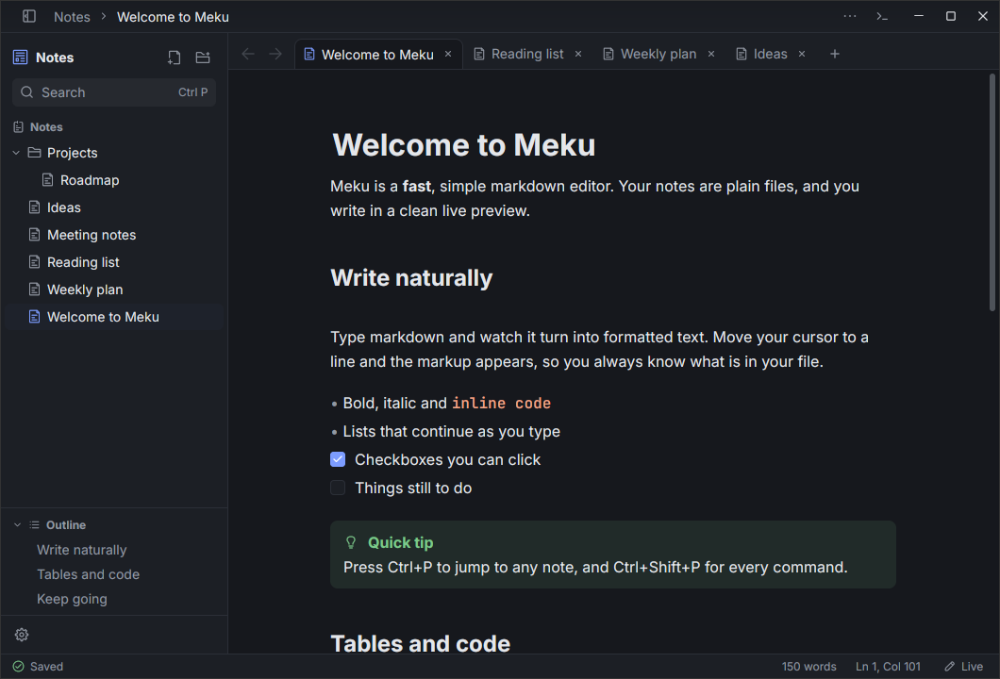
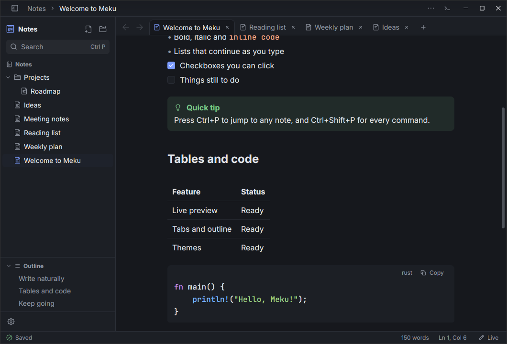
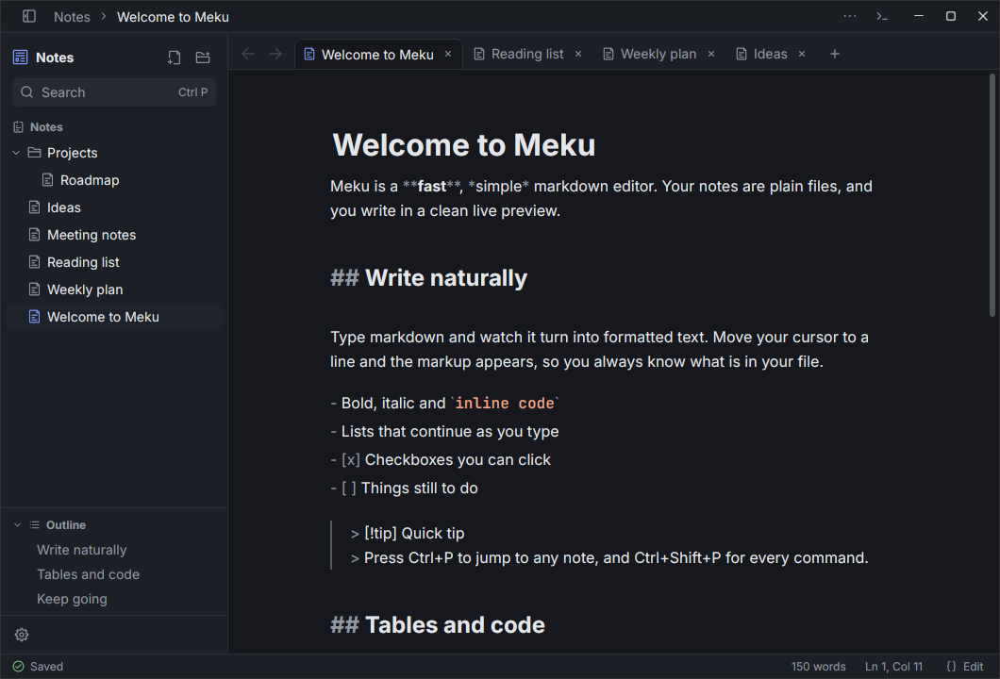
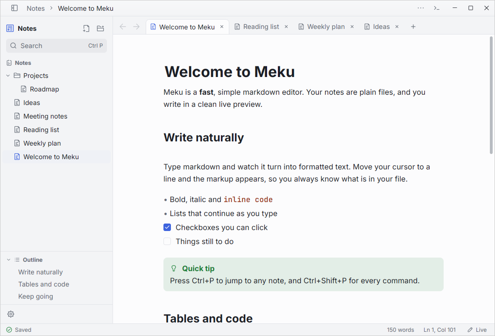
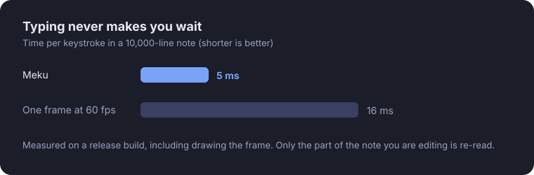

<p align="center">
  
</p>

<h1 align="center">Meku</h1>

<p align="center">
  <b>A fast, simple markdown editor for your notes.</b><br>
  Open a folder of plain <code>.md</code> files and write in a clean live preview.<br>
  A native app, with no browser inside. Free, offline, and yours.
</p>

<p align="center">
  
  
  
  
</p>

<p align="center">
  <a href="https://github.com/mebishp/meku/releases/latest"><b>Download Meku</b></a> ·
  <a href="#install">Install</a> ·
  <a href="#features">Features</a>
</p>

<br>

<p align="center">
  
  <br>
  <sub>Typing markdown, live formatting, and switching themes. A real recording of Meku.</sub>
</p>

<p align="center">
  
  <br>
  <sub>Live preview, tabs, a folder sidebar and a note outline.</sub>
</p>

<p align="center">
  <a href="#features">Features</a> ·
  <a href="#fast">Fast</a> ·
  <a href="#whats-in-version-01">What's in 0.1</a> ·
  <a href="#install">Install</a> ·
  <a href="#build-from-source">Build</a> ·
  <a href="#license">License</a>
</p>

<br>

<table>
  <tr>
    <td width="25%" valign="top">
      <h3>⚡ Fast</h3>
      Stays smooth, even in very long notes. Typing never waits.
    </td>
    <td width="25%" valign="top">
      <h3>📄 Plain files</h3>
      Your notes are ordinary <code>.md</code> files in a folder. Open them in any editor, any time.
    </td>
    <td width="25%" valign="top">
      <h3>✍️ Live preview</h3>
      Write markdown and see it formatted as you type. The markup only shows on the line you are on.
    </td>
    <td width="25%" valign="top">
      <h3>🔖 Remembers</h3>
      Opens your last folder and your tabs, right where you left them.
    </td>
  </tr>
</table>

<br>

## Features

<table>
  <tr>
    <td width="50%" valign="top">
      
      <h3>Write, don't format</h3>
      Headings, lists, checkboxes, tables, callouts and code blocks all look right as you type. Lists keep going when you press Enter, and brackets close themselves.
    </td>
    <td width="50%" valign="top">
      
      <h3>See the markdown when you want</h3>
      Switch to Edit to see every symbol, or stay in Live and let the markup appear only on the line you are editing. Nothing is hidden from you.
    </td>
  </tr>
  <tr>
    <td width="50%" valign="top">
      
      <h3>Read without distractions</h3>
      Read view shows the finished note, with nothing to click by accident. Links open with a plain click.
    </td>
    <td width="50%" valign="top">
      
      <h3>Light, dark, or yours</h3>
      Pick a light or dark theme, follow your system, or make your own. Change the look and feel in the settings (<code>Ctrl+,</code>), for every folder or just one.
    </td>
  </tr>
</table>

<br>

## Fast

<p align="center">
  
</p>

Meku is a native app, not a web page in a box, and it draws the screen on your graphics card. A few things keep it quick:

- **Only what you see is drawn.** A note with tens of thousands of lines scrolls as easily as a short one.
- **Only what you change is re-read.** Edit a line and Meku updates just that part of the note, so typing stays instant in long files. Re-reading a 47,500-line note from scratch takes about a fiftieth of a second.
- **Tabs wait their turn.** When you reopen Meku, only the note you are looking at is loaded. The other tabs load when you click them.
- **Scrolling feels precise.** Mouse wheel scrolling is short and exact, and you can set how far each notch moves.

## What's in version 0.1

<table>
  <tr>
    <td width="33%" valign="top">
      <h4>✍️ Writing</h4>
      Live preview, Edit and Read views · headings, bold, italic, strikethrough, highlights and inline code · bullet, numbered and task lists · tables · callouts · code blocks with colours · images (paste or drop them in) · a <code>/</code> menu for quick inserts · find and replace · go to line · autosave
    </td>
    <td width="33%" valign="top">
      <h4>🗂️ Organising</h4>
      Open any folder as a notes library · a sidebar to browse, create, rename and delete notes and folders · tabs · an outline of the open note · jump to any note with <code>Ctrl+P</code> · search every note with <code>Ctrl+Shift+F</code> · back and forward through the notes you visited · reopens your last folder and tabs
    </td>
    <td width="33%" valign="top">
      <h4>🎨 Make it yours</h4>
      Light and dark themes, or follow your system · your own themes · choose your fonts and text size · zoom · a narrow, comfortable, wide or full-width page · scroll bars and scroll speed · settings for every folder, or just one · a command palette (<code>Ctrl+Shift+P</code>) for everything else
    </td>
  </tr>
</table>

**Good to know:** Meku notices when a note is changed by another program while it is open, and it never renames or rewrites your files behind your back.

**Not in this first version:** links between notes, plugins and sync.

## Install

Download the file for your system from the [latest release](https://github.com/mebishp/meku/releases/latest).

| System | File | How |
|---|---|---|
| Ubuntu, Debian | `.deb` | `sudo apt install ./meku_0.1.0_amd64.deb` |
| Arch Linux | `.pkg.tar.zst` | `sudo pacman -U meku-0.1.0-1-x86_64.pkg.tar.zst` |
| Any Linux | `.AppImage` | Make it executable, then run it |
| Any Linux | `.tar.gz` | Unpack it and run `meku` |

Meku needs a graphics driver with Vulkan support, which most computers already have. It runs on Linux today; macOS and Windows may come later. Every file has a checksum in `SHA256SUMS`.

Start it from your app menu, or give it a folder:

```
meku ~/Notes
```

### A few shortcuts

| Keys | What it does |
|---|---|
| `Ctrl+O` | Open a folder |
| `Ctrl+P` | Jump to a note |
| `Ctrl+Shift+P` | Run any command |
| `Ctrl+T` | New note |
| `Ctrl+E` | Change view (Edit, Live, Read) |
| `Ctrl+F` | Find in the note |
| `Ctrl+Shift+F` | Search every note |
| `Ctrl+,` | Settings |

The full list is in the `⋯` menu at the top of the editor.

## Build from source

You need [Rust](https://rustup.rs) (a recent version).

```
git clone https://github.com/mebishp/meku.git
cd meku
cargo run --release
```

To build the install files (deb, AppImage, Arch and tar.gz), run `tools/package.sh`. They appear in `dist/`.

## License

Meku is released under the [Apache License 2.0](LICENSE).

The icons come from [Iconoir](https://iconoir.com) and keep their own license, which is included in [`crates/meku/assets/icons`](crates/meku/assets/icons).
