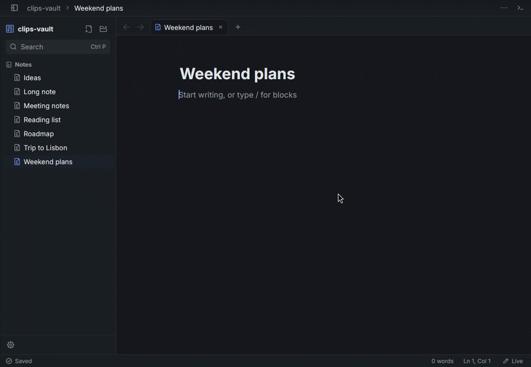
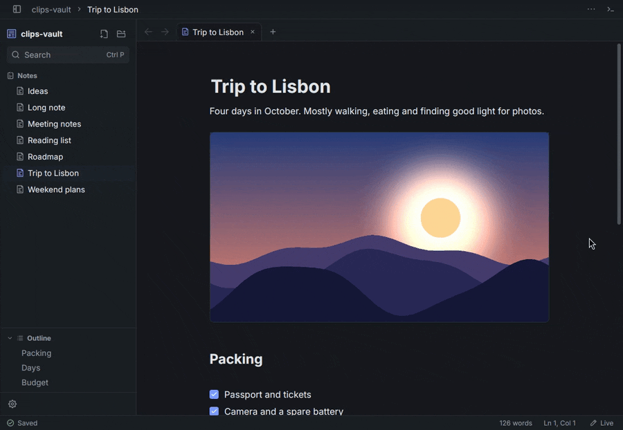
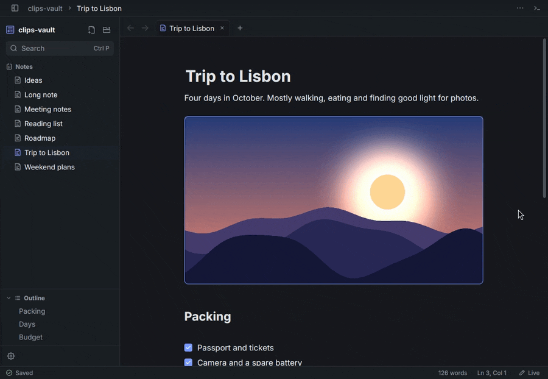
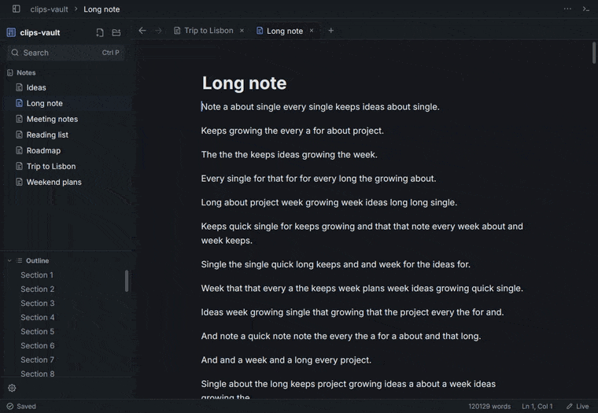

<div align="center">


# Meku

**A native markdown editor for folders of notes.**<br>
Live preview, tabs, an outline and themes. Written in Rust and drawn on the GPU.

[](https://github.com/mebishp/meku/releases/latest)
[](https://github.com/mebishp/meku/actions/workflows/ci.yml)
[](LICENSE)


[Download](https://github.com/mebishp/meku/releases/latest) &nbsp;·&nbsp; [Features](#features) &nbsp;·&nbsp; [Install](#install) &nbsp;·&nbsp; [Build](#build-from-source)

<br>



</div>

<br>

Open a folder and it becomes your notes. Every note is an ordinary `.md` file, so
you can open it in any other editor, sync it with whatever you already use, and
keep it in git. There is no database and no account, and Meku does not rewrite
your files behind your back.

- **Plain files.** A folder of markdown is the whole format.
- **Native.** No browser engine. The window is drawn on your graphics card.
- **Offline.** The only network use is an update check once a day, which you can
  [turn off](#updates-and-privacy).
- **Linux, macOS (Apple silicon) and Windows.**

## Features

### Live preview

Markdown turns into formatted text as you type. The symbols only show on the line
you are editing, so you can always see exactly what is in the file. Switch to
**Edit** to see every symbol, or **Read** for a finished page with nothing to edit
by accident (`Ctrl+E` cycles the three).

Headings, bold, italic, strikethrough, highlights, inline code, bullet, numbered
and task lists, tables, callouts, and code blocks with syntax colours all render
in place. Lists continue when you press Enter, and brackets close themselves. Type `/` for a menu of blocks to insert.

### Right-click menu



What the menu offers depends on what you clicked.

- **Selected text:** cut, copy, paste, the inline formats, paragraph styles
  (headings, quote, lists) and find.
- **A link:** open it, copy the address, or remove the link and keep the text.
- **A picture:** zoom, copy the image, copy its path, show it in your file
  manager, resize it, or remove it from the note. The file stays on disk, and
  `Ctrl+Z` brings the picture back.
- **A code block:** copy the code.
- **Anywhere else:** undo, paste, and inserts such as a table, a callout or a divider.

Entries show their keyboard shortcut where there is one.

### Themes


Light and dark themes are built in, and Meku can follow your system setting.
`Ctrl+Alt+T` steps through them. You can make your own, choose the fonts and text
size, zoom, and pick a narrow, comfortable, wide or full-width page. Settings
(`Ctrl+,`) can apply to every folder or just one.

### Getting around



`Ctrl+P` jumps to any note by name. `Ctrl+Shift+F` searches the text of every
note. `Ctrl+Shift+P` opens a palette of every command. There are tabs, a folder
sidebar, an outline of the open note, and back and forward buttons for the notes
you visited. When you reopen Meku it brings back your folder and tabs, loading
only the note you are looking at until you click the others.

### Long notes stay fast



Only the lines on screen are drawn, and an edit only re-reads the part of the
note it touched. In our tests, typing in a 10,000-line note is handled in about
5 ms, well under the 16 ms of one frame at 60 Hz. Re-reading a 47,500-line note
from scratch takes about 20 ms.

### Pictures

Paste a screenshot, paste picture files from your file manager, or drop files on
the window. They are copied into an `attachments` folder next to the note and
linked. Click a picture to see it full size. `Ctrl+C` on a picture's line copies
the picture itself.

### And

- Find and replace, go to line, autosave
- Notices when another program changes an open note
- Scroll bars, adjustable wheel speed
- Settings for every folder, or just one

Not in this version: links between notes, plugins and sync.

## Install

Download the file for your system from the
[latest release](https://github.com/mebishp/meku/releases/latest).

| System | File | How |
|---|---|---|
| macOS (Apple silicon) | `.dmg` | Open it and drag Meku to Applications |
| Windows (64-bit) | `.zip` | Unzip and run `Meku.exe` |
| Ubuntu 22.04+, Debian 12+ | `.deb` | `sudo apt install ./meku_1.0.2_amd64.deb` |
| Arch Linux | `.pkg.tar.zst` | `sudo pacman -U meku-1.0.2-1-x86_64.pkg.tar.zst` |
| Other Linux (glibc 2.35+) | `.AppImage` | `chmod +x` it, then run it |
| Other Linux (glibc 2.35+) | `.tar.gz` | Unpack and run `meku`; `INSTALL.txt` lists the libraries |

Meku needs a graphics driver with modern API support: Vulkan on Linux, Metal on
macOS, DirectX on Windows. Most computers already have one. Intel Macs are not
supported yet. Each release includes `SHA256SUMS`.

The macOS and Windows builds are not signed yet. On macOS, right-click Meku,
choose **Open**, and confirm. On Windows, choose **More info** then **Run anyway**
in the SmartScreen warning.

Start it from your app menu, or give it a folder:

```
meku ~/Notes
```

### Updates and privacy

Once a day Meku asks GitHub for the public list of releases. Nothing about you or
your notes is sent. If a newer version exists, a chip appears in the status bar,
and clicking it shows the steps for the way you installed Meku (deb, Arch,
AppImage, tarball, macOS app, Windows or source).

To turn this off, untick **Check for updates** in Settings. Meku then never goes
online. **Check for updates** in the command palette still works when you ask.

On Linux with Wayland (GNOME, for example), copying a picture out of Meku needs
`xclip` or `wl-clipboard` installed. Pasting works everywhere.

<details>
<summary><b>Keyboard shortcuts</b></summary>

<br>

On a Mac, use `Cmd` where this says `Ctrl`. The full list is in the `...` menu at
the top of the editor.

| Keys | Action |
|---|---|
| `Ctrl+O` | Open a folder |
| `Ctrl+P` | Jump to a note |
| `Ctrl+Shift+P` | Command palette |
| `Ctrl+T` | New note |
| `Ctrl+E` | Cycle Edit, Live and Read |
| `Ctrl+F` | Find in the note |
| `Ctrl+Shift+F` | Search every note |
| `Ctrl+B` / `Ctrl+I` | Bold / italic |
| `Ctrl+K` | Link |
| `Ctrl+Alt+T` | Next theme |
| `Ctrl+,` | Settings |

</details>

## Build from source

You need a recent [Rust](https://rustup.rs) toolchain.

```
git clone https://github.com/mebishp/meku.git
cd meku
cargo run --release
```

`tools/package.sh` builds the Linux packages (deb, AppImage, Arch and tar.gz)
into `dist/`. `tools/demo/` has the scripts that recorded the clips above.

## License

Apache License 2.0, see [LICENSE](LICENSE). The icons come from
[Iconoir](https://iconoir.com) and keep their own license, included in
[`crates/meku/assets/icons`](crates/meku/assets/icons).
